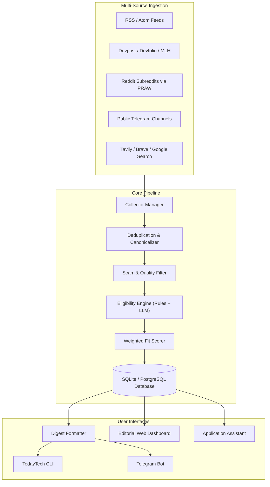

# TodayTech 🎯

[](LICENSE)
[](https://www.python.org/downloads/)
[](https://github.com/astral-sh/ruff)
[](http://mypy-lang.org/)
[](Dockerfile)

> **Your personal, self-hosted opportunity-radar agent.** TodayTech scans the web for hackathons, fellowships, internships, scholarships, grants, and competitions you are eligible for, ranks them against your profile, filters out scams, and assists you in drafting winning application materials.

---

## 🌟 Why TodayTech?

Searching for opportunities manually means drowning in noise: expired deadlines, country-restricted programs, scam pay-to-apply competitions, and duplicate listings across forums.

**TodayTech runs privately for you:**
- 🛡️ **Scam & Quality Filter:** Automatically flags pay-to-apply schemes, shady link shorteners, and unverifiable organizers.
- 🔍 **Strict Eligibility Engine:** Hard checks (country, citizenship, education level, field of study, fees) combined with an LLM for nuanced eligibility evaluation. Never makes blind guesses.
- 📊 **Tailored Fit Scoring (0–100):** Balances your skills, interests, reward value, and deadline feasibility using customizable weights.
- 🎨 **Warm Editorial Web Dashboard:** Clean, distraction-free visual interface inspired by high-end print publications (no generic dark-mode AI clichés!).
- 🤖 **Interactive Telegram Bot:** Daily/weekly digests, instant search, bookmarking, and on-demand mobile alerts.
- ✍️ **Application Assistant:** Breaks down requirements into a checklist and auto-generates tailored motivation letters and project proposals in `.md` and `.docx`.
- 🔒 **100% Private & Open Source:** Zero tracking. Zero telemetry. All user data, credentials, and drafts live in gitignored local files on your machine.

---

## 🏛️ System Architecture



---

## ⚡ 5-Minute Quick Start

### 1. Prerequisites
- **Python 3.12+** installed on your system.
- Git.

### 2. Clone and Install
```bash
git clone https://github.com/your-username/TodayTech.git
cd TodayTech

# Create virtual environment
python -m venv .venv

# Activate virtual environment:
# On Linux/macOS:
source .venv/bin/activate
# On Windows PowerShell:
.\.venv\Scripts\Activate.ps1
# On Windows Git Bash:
source .venv/Scripts/activate

# Install in editable mode
pip install -e .
```

### 3. Configure Your Environment
Copy `.env.example` to `.env`:
```bash
cp .env.example .env
```
Open `.env` and fill in your keys (see [Step-by-Step API Keys Guide](#-step-by-step-free-api-keys-guide) below for free key links).

```ini
# LLM Brain (100% Free)
LLM_PROVIDER=gemini
GEMINI_API_KEY=your_gemini_key_here

# Web Search (1,000 free searches/month)
TAVILY_API_KEY=your_tavily_key_here

# Telegram Bot (Optional, 100% Free)
TELEGRAM_BOT_TOKEN=your_token_from_botfather
TELEGRAM_USER_ID=your_numeric_user_id
```

### 4. Create Your Profile
Copy `profile.example.yaml` to `profile.yaml`:
```bash
cp profile.example.yaml profile.yaml
```
*(Or run `todaytech init` for an interactive onboarding wizard, or edit it in the web dashboard!)*

### 5. Launch TodayTech!

#### Option A: Launch the Web Dashboard 🎨
```bash
todaytech web
```
Open **[http://localhost:8000](http://localhost:8000)** in your browser to explore your opportunity radar, filter matches, and draft application materials.

#### Option B: Launch the Telegram Bot 📱
```bash
todaytech run
```
Message your bot `/start` or `update me` in Telegram for daily push updates.

---

## 🔑 Step-by-Step Free API Keys Guide

TodayTech is engineered to run on **100% free tiers** with zero credit card required:

| Service | Free Tier Limits | Purpose | Setup Time | Required? |
| :--- | :--- | :--- | :--- | :--- |
| **[Google AI Studio](https://aistudio.google.com/app/apikey)** | Generous free RPM | Evaluates eligibility, fit scoring & application drafts | 1 min | **Required** for AI scans & drafts |
| **[Tavily Search](https://tavily.com)** | 1,000 searches/mo | Crawls web for new hackathons and scholarships | 1 min | **Required** for live web scans |
| **[Telegram @BotFather](https://t.me/BotFather)** | Unlimited | Connects your mobile Telegram bot | 1 min | Optional (only for Telegram) |
| **[Telegram @userinfobot](https://t.me/userinfobot)** | Instant | Provides your user ID to secure your bot | 30 sec | Optional (only for Telegram) |
| **[Reddit OAuth](https://www.reddit.com/prefs/apps)** | Free | Ingests r/hackathons, r/csMajors, etc. | 2 min | Optional |

### 1. Google Gemini Key (Free LLM)
1. Visit **[Google AI Studio](https://aistudio.google.com/app/apikey)**.
2. Sign in with any Google account.
3. Click **"Create API key"** and copy the string into `GEMINI_API_KEY` in `.env`.

### 2. Tavily Search Key (Free Search API)
1. Visit **[Tavily.com](https://tavily.com)** and sign in with Google/GitHub.
2. Copy your free API key and paste into `TAVILY_API_KEY` in `.env`.

### 3. Telegram Bot Token & User ID (Free)
1. In Telegram, search for **`@BotFather`** and send `/newbot`.
2. Give your bot a display name and username ending in `bot` (e.g. `my_opportunity_radar_bot`).
3. Copy the token into `TELEGRAM_BOT_TOKEN`.
4. Search for **`@userinfobot`** and send `/start` to copy your numeric ID into `TELEGRAM_USER_ID`.

---

## 🖥️ CLI Commands Reference

TodayTech includes a fast terminal interface:

| Command | Description |
| :--- | :--- |
| `todaytech web` | Launch the warm editorial Web Dashboard (`http://localhost:8000`) |
| `todaytech run` | Start the interactive Telegram bot daemon |
| `todaytech init` | Interactive terminal onboarding wizard to build `profile.yaml` |
| `todaytech scan` | Crawl sources, evaluate eligibility with AI, and update the database |
| `todaytech digest` | Render and display the latest personalized digest in your terminal |
| `todaytech list` | Browse active opportunities with interactive filters (`--type`, `--min-score`) |
| `todaytech details <id>` | View complete metadata, requirements, and eligibility reasoning |
| `todaytech apply <id>` | Launch Application Assistant to generate tailored `.md` and `.docx` drafts |
| `todaytech test-sources` | Health-check all RSS feeds, platforms, and API endpoints |

---

## 💬 Telegram Bot Reference

Control your radar anywhere from Telegram:
- `/start` — Welcome message and quick overview
- `update me` — Run a fresh scan and push today's personalized digest
- `only scholarships` / `only hackathons` — Filter matches by category
- `deadlines` — View urgent upcoming deadlines
- `details <id>` — Inspect full eligibility breakdown and requirements
- `apply <id>` — Generate application drafts and download `.docx` files
- `save <id>` / `saved` — Track opportunities in your personal pipeline

---

## 🐳 Docker & Docker Compose

Deploy TodayTech effortlessly on your home server, VPS, or Raspberry Pi.

```bash
# 1. Prepare configuration files
cp .env.example .env
cp profile.example.yaml profile.yaml

# 2. Build and start container in the background
docker compose up -d

# 3. View live logs
docker compose logs -f
```

All database files and generated application drafts persist in `./data`.

---

## 🌍 Community Source Packs

TodayTech includes modular source packs located in `sources/packs/`:
- `sources/packs/ghana.yaml` — Curated tech hubs, scholarships, and fellowships for Ghanaian and West African developers.
- *More coming soon!*

To create and contribute a source pack for your region or field, simply drop a YAML file in `sources/packs/<name>.yaml` and submit a Pull Request. See [CONTRIBUTING.md](CONTRIBUTING.md).

---

## 🛠️ Troubleshooting

#### `todaytech: command not found`
You haven't installed the package in your active Python environment. Run:
```bash
# Activate your virtual environment first
source .venv/bin/activate      # Linux / macOS / Git Bash
.\.venv\Scripts\Activate.ps1    # Windows PowerShell

# Or run directly via executable
.\.venv\Scripts\todaytech web
```

#### `Scan failed: At least one Search API key is required`
Live web scanning requires search capability to crawl outside static RSS feeds. Add your free Tavily key into `.env`:
```ini
TAVILY_API_KEY=tvly-your_key_here
```

#### `Telegram bot doesn't reply`
Verify that `TELEGRAM_USER_ID` in `.env` matches your exact numeric Telegram ID. TodayTech silently ignores messages from unauthorized users for your security.

---

## 🔒 Privacy & Open-Source Commitment

- **Zero Telemetry:** No user analytics, error tracking beacons, or third-party tracking scripts.
- **Strictly Local Storage:** All opportunity history, profile information, and generated documents stay on your machine.
- **Gitignored by Default:** `.env`, `profile.yaml`, and `data/` are pre-configured in `.gitignore`.

---

## 🤝 Contributing

Contributions are welcome! Please check out [CONTRIBUTING.md](CONTRIBUTING.md) for details on code style, pre-commit checks, adding collectors, and running the test suite.

---

## 📄 License

This project is licensed under the [MIT License](LICENSE).
